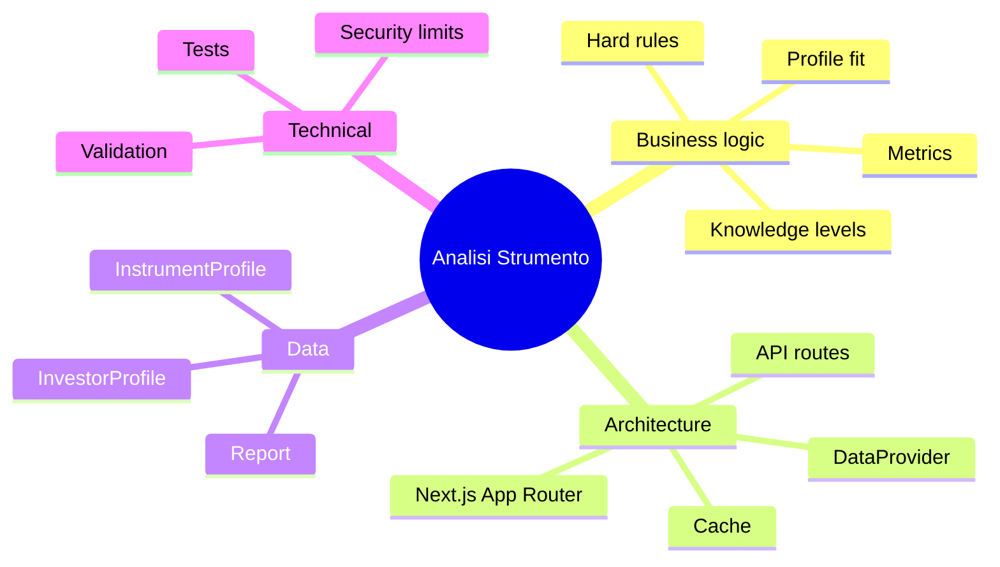

# Documentation

| Doc | What it covers |
|---|---|
| [business-logic.md](business-logic.md) | Product rules, user flow, every metric and how it is computed, profile-fit rules, knowledge levels |
| [architecture.md](architecture.md) | Components, layers, request flows (search, report, AI summary), module map |
| [data-structures.md](data-structures.md) | Types, API contracts, localStorage schema, cache entries, the Yahoo → domain mapping |
| [coding-standards.md](coding-standards.md) | Lint, format, type and test tools; code, naming and git conventions |
| [technical-details.md](technical-details.md) | Caching, security limits, AI-summary validation, testing, known limits, how to swap the data provider |

Diagrams are [Mermaid](https://mermaid.js.org/). They render on GitHub, in VS Code (Markdown Preview Mermaid extension) and in most Markdown viewers.

