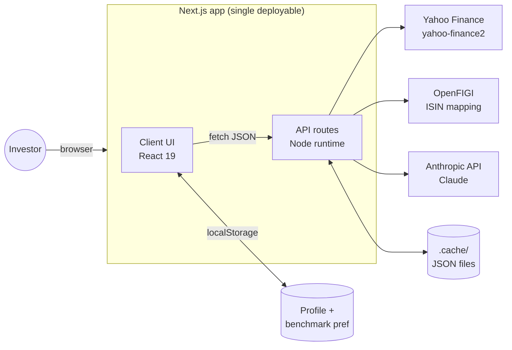
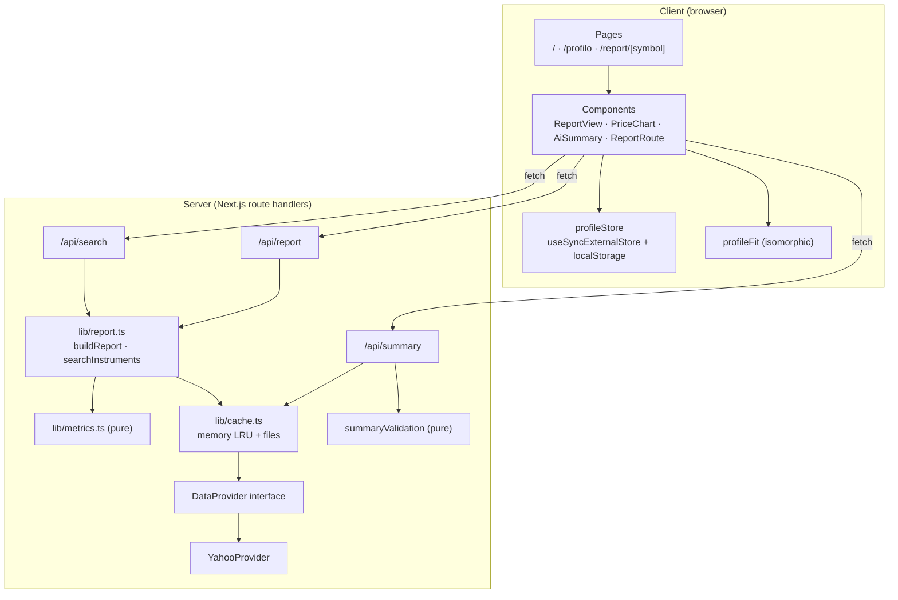
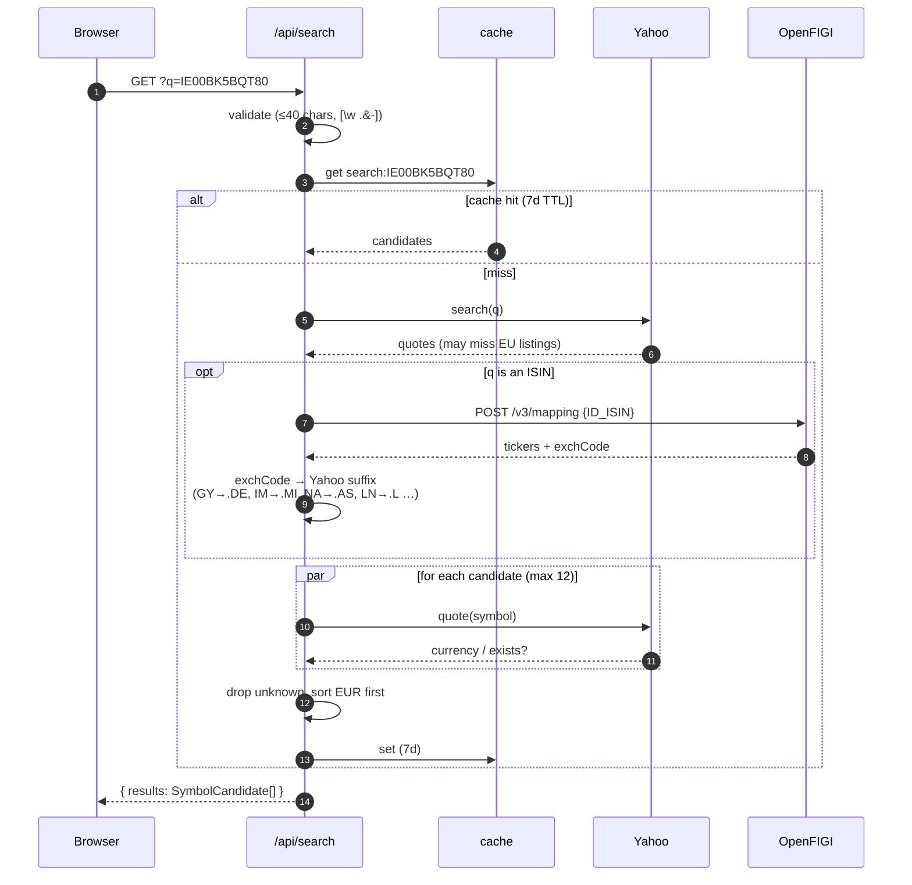
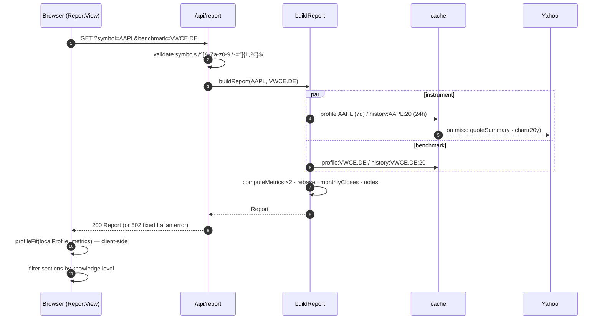
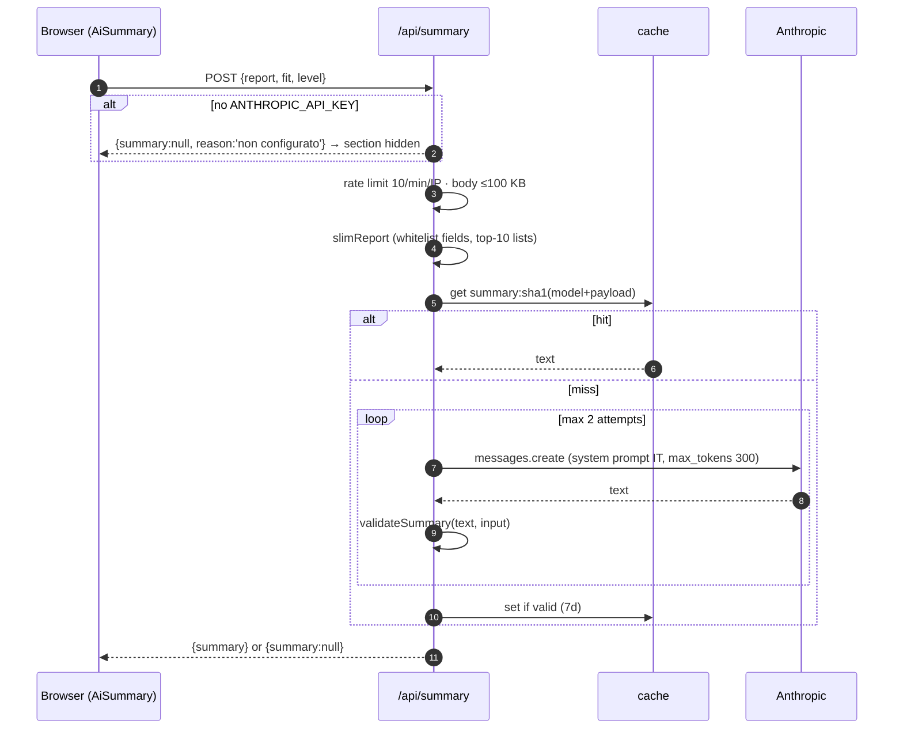
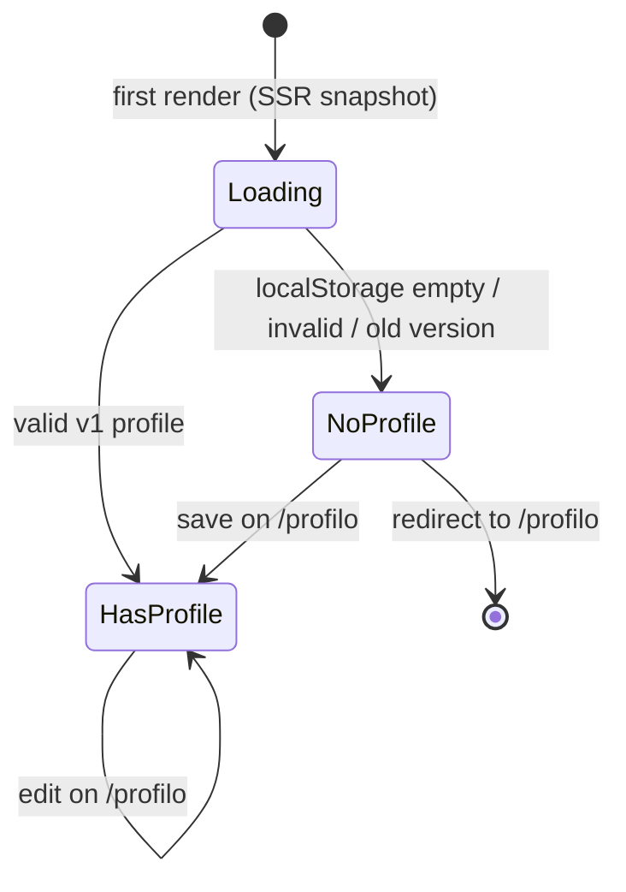

# Architecture

## 1. System context



- **No database and no accounts.** The only persisted user data is in the browser.
- **Every external call is server-side.** API keys stay in `.env.local` and are never in the client bundle.

## 2. Layers



`profileFit`, `metrics` and `summaryValidation` are **pure modules**. They have no I/O and are unit-tested, so the same code can run on the server or the client.

## 3. Request flows

### 3.1 Search (ISIN or ticker)



### 3.2 Report



### 3.3 AI summary



## 4. Module map

```
src/
├── app/
│   ├── layout.tsx              header, skip link, disclaimer footer
│   ├── page.tsx                search (redirects to /profilo if no profile)
│   ├── profilo/page.tsx        onboarding / edit form
│   ├── report/[symbol]/page.tsx  → <ReportRoute/>
│   └── api/
│       ├── search/route.ts     GET  → searchInstruments
│       ├── report/route.ts     GET  → buildReport
│       └── summary/route.ts    POST → Claude + validation
├── components/
│   ├── ReportRoute.tsx         reads + decodes the [symbol] param
│   ├── ReportView.tsx          fetch report, compute fit, level filtering, sections
│   ├── PriceChart.tsx          Recharts line chart (rebased = 100)
│   └── AiSummary.tsx           calls /api/summary, hides on null
└── lib/
    ├── data/
    │   ├── types.ts            domain types
    │   ├── provider.ts         DataProvider interface
    │   └── yahoo.ts            Yahoo + OpenFIGI implementation
    ├── report.ts               orchestration + caching keys
    ├── metrics.ts              pure math
    ├── profileFit.ts           pure fit rules (isomorphic)
    ├── profileValidation.ts    pure form validation
    ├── profileStore.ts         localStorage hooks (client)
    ├── summaryValidation.ts    pure number / word checks for AI output
    ├── cache.ts                memory LRU + file cache, in-flight de-dup
    └── format.ts               it-IT number / % / date formatting
```

## 5. Client state



`profileStore` uses `useSyncExternalStore` and the `storage` event, so edits in another tab propagate. Every localStorage read and write is in a try/catch, so private mode or blocked storage degrades to "no profile".

## 6. Tech stack

| Concern     | Choice                                                                    |
| ----------- | ------------------------------------------------------------------------- |
| Framework   | Next.js 16 (App Router, `cacheComponents`), React 19, TypeScript          |
| Styling     | Tailwind CSS 4, light theme, neutral slate/blue palette                   |
| Charts      | Recharts                                                                  |
| Market data | `yahoo-finance2` v4 (unofficial) + OpenFIGI REST                          |
| LLM         | `@anthropic-ai/sdk`, model `ANTHROPIC_MODEL` (default `claude-haiku-5-5`) |
| Tests       | Vitest                                                                    |
