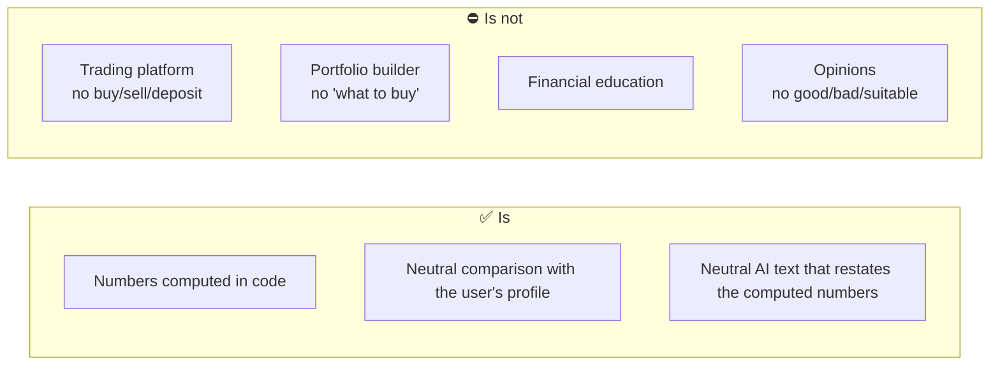
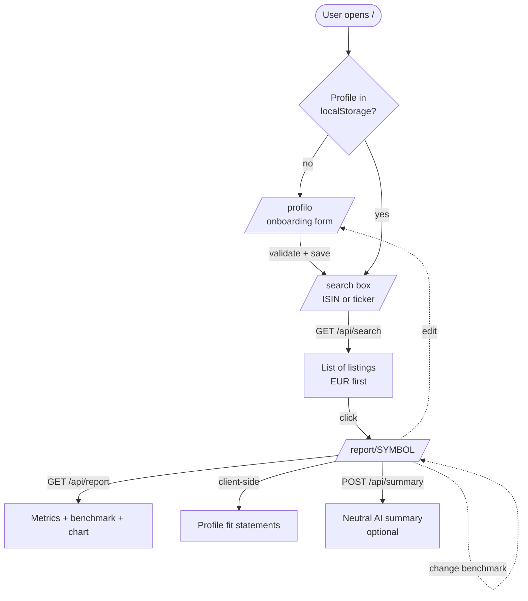
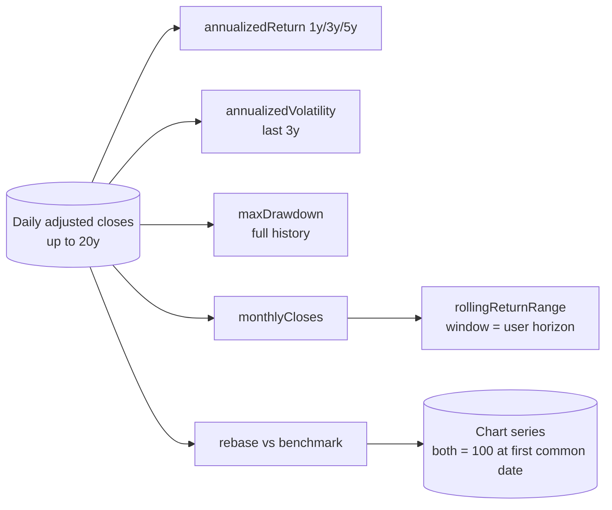
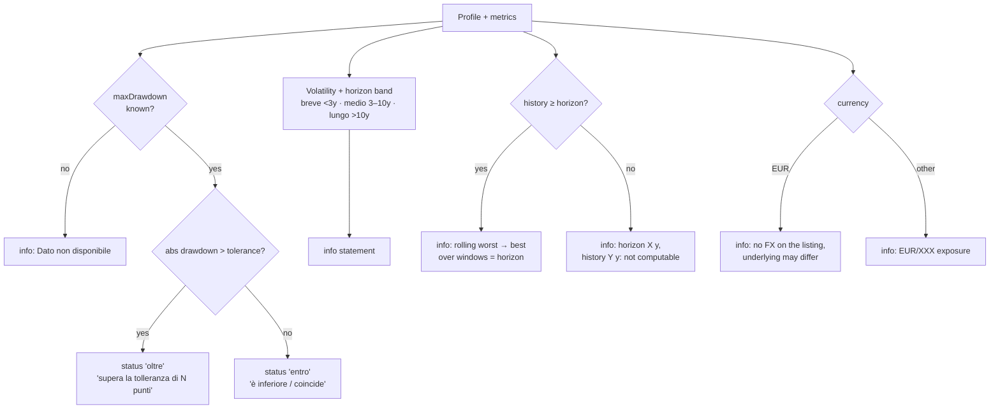
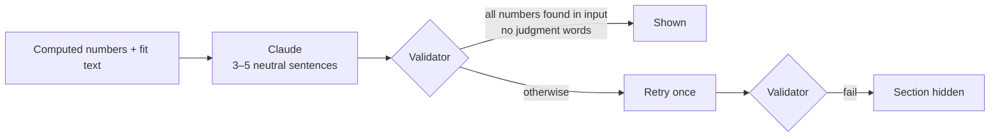

# Business logic

## 1. What the product is (and is not)

The app takes one instrument (ETF or stock) and shows **facts and numbers**, plus how those numbers compare to the investor profile the user entered. It never judges.

Rules enforced in code:

| Rule | Where |
|---|---|
| Disclaimer *"Informazioni a scopo informativo, non è consulenza finanziaria."* on every page | `src/app/layout.tsx` footer |
| Missing data is shown as **"Dato non disponibile"**, never estimated | `NA` constant in `src/lib/profileFit.ts`, used by `ReportView` |
| No judgment words in generated text | Forbidden-word regex in tests (`profileFit.test.ts`, `report.test.ts`) and at runtime for the AI summary (`summaryValidation.ts`) |
| Fit statuses are neutral labels, not verdicts | `STATUS_LABEL`: "entro / oltre la soglia indicata", grey styling |

## 2. User flow

## 3. Investor profile

Collected once, editable at any time at `/profilo`, stored only in the browser.

| Field | Meaning | Validation |
|---|---|---|
| `age` | Current age | integer 18–100 |
| `horizonYears` | Investment horizon | integer 1–80 |
| `retirementAge` | Target retirement age | integer 30–100, ≥ age |
| `netWorthEur` | Invested net worth (approx.), EUR | number ≥ 0, ≤ 10¹⁰ |
| `maxDrawdownPct` | Max acceptable loss on the **whole portfolio**, % (20 ⇒ −20%) | 1–99 |
| `knowledge` | `base` / `intermedio` / `avanzato` | required |

Non-blocking warning: when `horizonYears > retirementAge − age` the form shows a note but still saves. The user's choice wins.

## 4. Metrics (computed in code from daily adjusted closes)

All metrics are pure functions in `src/lib/metrics.ts`. Up to 20 years of history are requested.

| Metric | Formula | Undefined when |
|---|---|---|
| **Annualized return (N y)** | CAGR = (P_last / P_start)^(1 / elapsed_years) − 1. `P_start` = last close on or before *last date − N years*. Uses the **actual** elapsed span. | history starts more than 7 days after the target date |
| **Volatility** | sample std-dev of daily simple returns × √252, over the last 3 years (or less if not available); the years used are shown | < 22 points in the window |
| **Max drawdown** | min over time of (close / running peak − 1); peak and trough dates kept | < 2 points |
| **Rebased chart** | intersect dates of instrument and benchmark, both divided by their first common close × 100 | no common date |
| **Rolling return range** | for each monthly close, CAGR to the close ≈ *horizon* years later (16-day slack); keep worst and best | history shorter than the horizon |

Worked example: a max drawdown of −60.9% means that at the worst point the price was 60.9% below its previous peak.

> Prices are in the **listing currency**. When instrument and benchmark currencies differ, the report adds a note that the comparison ignores FX.

## 5. Profile fit rules

`profileFit(profile, {maxDrawdown, volatility, currency, monthly})` in `src/lib/profileFit.ts`. It is pure and runs in the browser, so the profile never leaves the device (except the fit text sent to the AI summary).

Output example (AAPL, profile tolerance 25%, horizon 10y):

| id | status | text |
|---|---|---|
| drawdown | `oltre` | Il drawdown massimo storico (-61%) supera la tolleranza indicata (-25%) di 36 punti. … |
| volatility | `info` | Volatilità annua 27%; orizzonte indicato 10 anni (orizzonte medio). |
| rolling | `info` | Su finestre mobili di 10 anni (121 osservazioni mensili, storico di 20,0 anni) il rendimento annualizzato storico è andato da 20,9% a 32,9%. |
| currency | `info` | Lo strumento è quotato in USD: esposizione al cambio EUR/USD. … |

## 6. Knowledge levels

The level comes from the profile and can be overridden per report with the "Livello di dettaglio" selector (not saved).

| Section | base | intermedio | avanzato |
|---|:-:|:-:|:-:|
| Header (name, type, currency, exchange, ISIN) | ✅ | ✅ | ✅ |
| TER | ✅ | ✅ | ✅ |
| Longest available return (5y → 3y → 1y) | ✅ | | |
| Returns 1y / 3y / 5y | | ✅ | ✅ |
| Volatility | | ✅ | ✅ |
| Max drawdown | ✅ | ✅ | ✅ |
| Drawdown peak/trough dates, history range | | | ✅ |
| Price chart vs benchmark | ✅ | ✅ | ✅ |
| Benchmark side-by-side table | | ✅ | ✅ |
| Composition (top holdings, sectors) | | ✅ (top) | ✅ (all + countries) |
| Stock fundamentals | | ✅ | ✅ |
| Profile fit (incl. rolling range) | ✅ | ✅ | ✅ |
| Notes | | | ✅ |
| AI summary (depth follows level) | ✅ | ✅ | ✅ |

## 7. Benchmark

- Default: **VWCE.DE** (Vanguard FTSE All-World UCITS ETF Acc, Xetra, EUR).
- The user can type any symbol. The choice persists in localStorage (`benchmarkSymbol`).
- If the benchmark fails, the report still renders, with a benchmark error message.

## 8. AI summary (business view)

The LLM **only restates** numbers that already exist. It never computes or adds a number.

