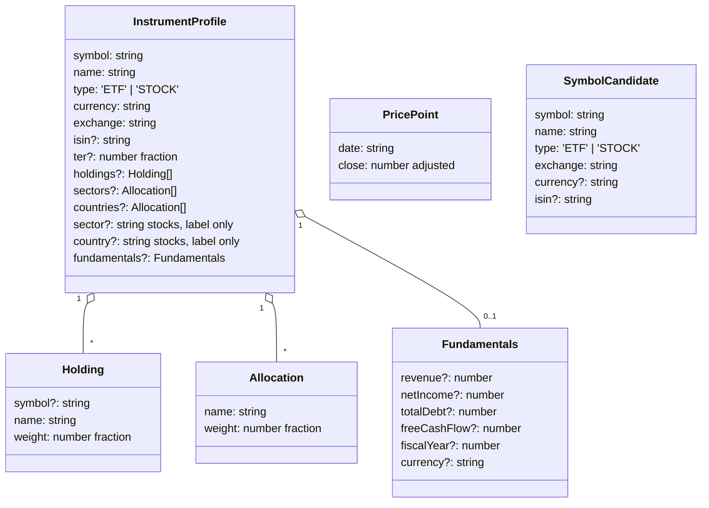
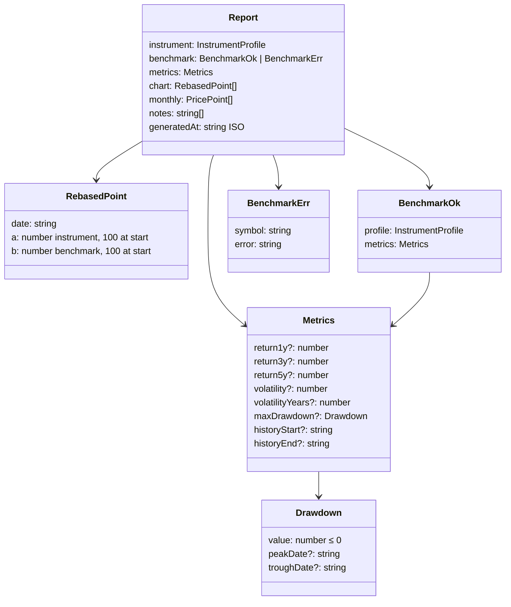
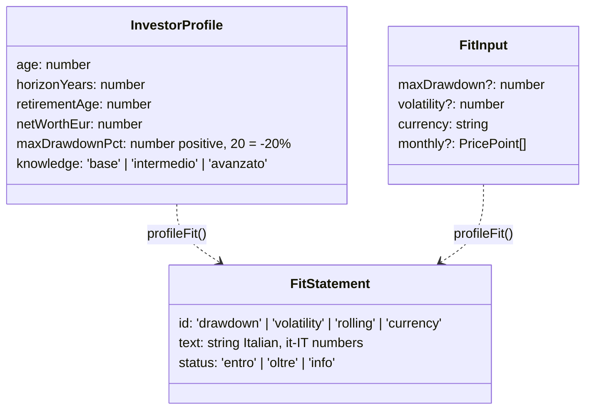
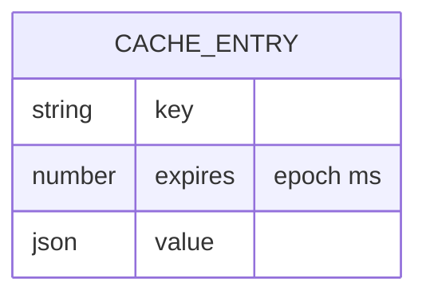
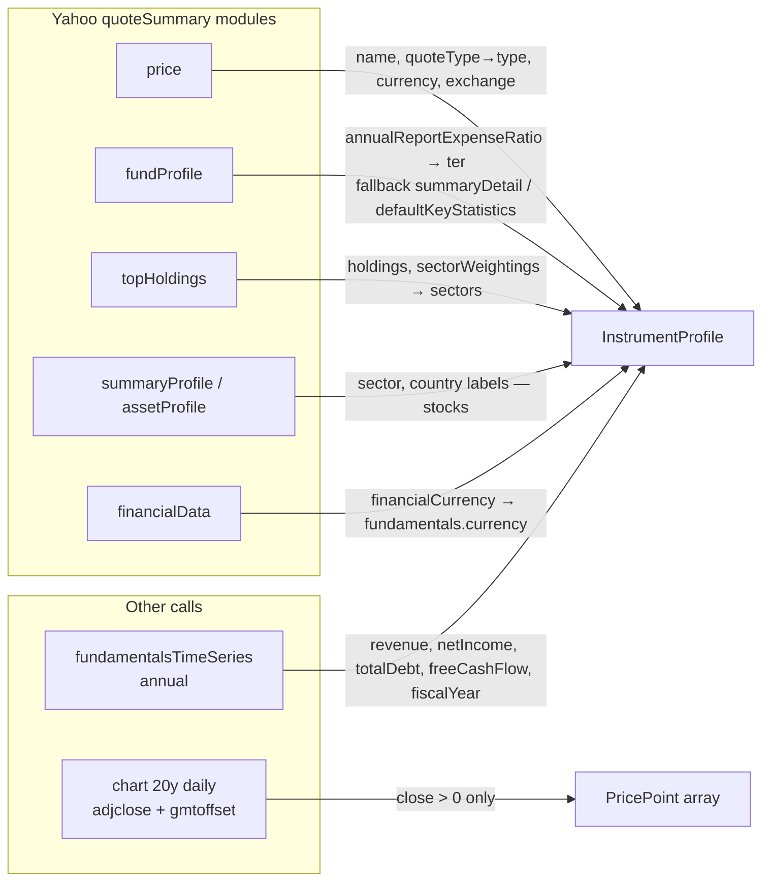

# Data structures

Conventions:

- **Percentages are fractions** everywhere in data: `0.0022` = 0.22%, `-0.341` = −34.1%. Formatting to it-IT happens only in the UI (`lib/format.ts`) and in fit texts.
- **Dates** are ISO `YYYY-MM-DD` strings, taken from the exchange's calendar day (Yahoo `gmtoffset` applied).
- **Optional = unknown.** An absent field means the source did not provide it, and the UI shows "Dato non disponibile".

## 1. Domain model



## 2. Report (response of `GET /api/report`)



Trimmed real response (AAPL, values rounded to 4 decimals):

```json
{
  "instrument": {
    "symbol": "AAPL",
    "name": "Apple Inc.",
    "type": "STOCK",
    "currency": "USD",
    "exchange": "NasdaqGS",
    "sector": "Technology",
    "fundamentals": { "revenue": 416161000000, "fiscalYear": 2025, "currency": "USD" }
  },
  "metrics": {
    "return1y": 0.3086,
    "return3y": 0.2399,
    "return5y": 0.1928,
    "volatility": 0.2682,
    "volatilityYears": 3,
    "maxDrawdown": { "value": -0.6087, "peakDate": "2007-12-28", "troughDate": "2009-01-20" },
    "historyStart": "2006-10-12",
    "historyEnd": "2026-10-09"
  },
  "benchmark": { "profile": { "symbol": "VWCE.DE", "...": "..." }, "metrics": { "...": "..." } },
  "chart": [{ "date": "2019-07-29", "a": 100, "b": 100 }],
  "monthly": [{ "date": "2006-10-12", "close": 2.251 }],
  "notes": [
    "I prezzi sono nelle rispettive valute di quotazione (USD e EUR); il confronto non include l'effetto cambio."
  ],
  "generatedAt": "2026-10-12T11:53:43.574Z"
}
```

## 3. Investor profile and fit



## 4. Browser storage (localStorage)

| Key               | Value                               | Notes                                                                         |
| ----------------- | ----------------------------------- | ----------------------------------------------------------------------------- |
| `investorProfile` | `{"v":1,"profile":InvestorProfile}` | Re-validated on read. A wrong version or invalid data counts as "no profile". |
| `benchmarkSymbol` | `"VWCE.DE"`                         | Empty means use the default                                                   |

## 5. API contracts

| Endpoint            | Request                                                                          | 200 response                                          | Errors                                                             |
| ------------------- | -------------------------------------------------------------------------------- | ----------------------------------------------------- | ------------------------------------------------------------------ |
| `GET /api/search`   | `q` ≤ 40 chars, `[\w .&-]`                                                       | `{ results: SymbolCandidate[] }` (EUR listings first) | 400 invalid input · 502 upstream                                   |
| `GET /api/report`   | `symbol`, optional `benchmark` (default `VWCE.DE`), `/^[A-Za-z0-9.\-=^]{1,20}$/` | `Report`                                              | 400 invalid · 502 `"Strumento non trovato o dati non disponibili"` |
| `POST /api/summary` | `{ report, fit: FitStatement[], level }` ≤ 100 KB                                | `{ summary: string }` or `{ summary: null, reason }`  | 400 invalid · 413 too large · 429 rate limit                       |

What `/api/summary` actually sends to Claude, after `slimReport` whitelists the client body:

```json
{
  "livello": "intermedio",
  "report": {
    "instrument": { "symbol", "name", "type", "currency", "exchange", "isin", "ter",
                    "holdings[≤10]", "sectors[≤10]", "countries[≤10]", "sector", "country", "fundamentals" },
    "metrics":   { "return1y", "return3y", "return5y", "volatility", "volatilityYears", "maxDrawdown", "historyStart", "historyEnd" },
    "benchmark": { "symbol", "name", "metrics" },
    "notes": ["≤5 × ≤300 chars"]
  },
  "fit": ["≤10 × ≤500 chars (statement texts only)"]
}
```

The investor profile itself (age, net worth…) is **not** sent. Only the fit sentences derived from it are.

## 6. Cache entries



| Key pattern                       | Value                       | TTL      |
| --------------------------------- | --------------------------- | -------- |
| `search:<QUERY UPPERCASE>`        | `SymbolCandidate[]`         | 7 days   |
| `profile:<symbol>`                | `InstrumentProfile`         | 7 days   |
| `history:<symbol>:20`             | `PricePoint[]` (daily, 20y) | 24 hours |
| `summary:<sha1(model + payload)>` | `string`                    | 7 days   |

File name: `.cache/<sanitized key ≤60 chars>-<sha1 16 hex>.json`.

## 7. Yahoo → domain mapping



Typical coverage:

| Field        | US stock   | EU-listed UCITS ETF                 |
| ------------ | ---------- | ----------------------------------- |
| Prices 5y+   | ✅         | ✅ (since listing)                  |
| TER          | n/a        | ⚠️ patchy (IWDA.AS yes, VWCE.DE no) |
| Top holdings | n/a        | ✅ ~10                              |
| Sectors      | label only | ✅                                  |
| Countries    | label only | ❌                                  |
| Fundamentals | ✅         | n/a                                 |
