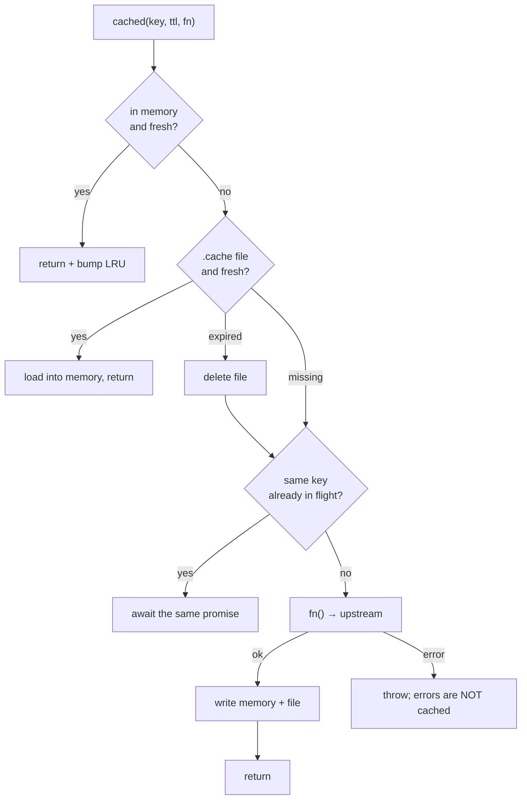
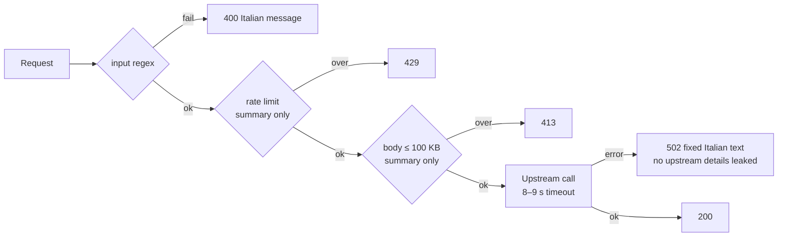
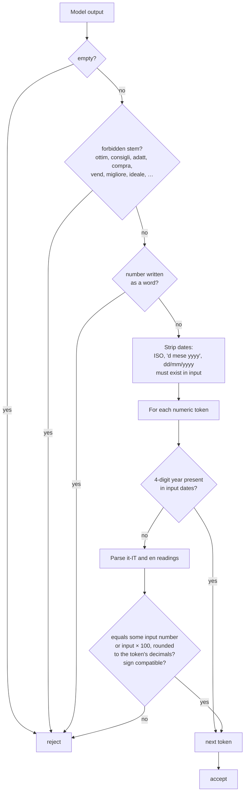
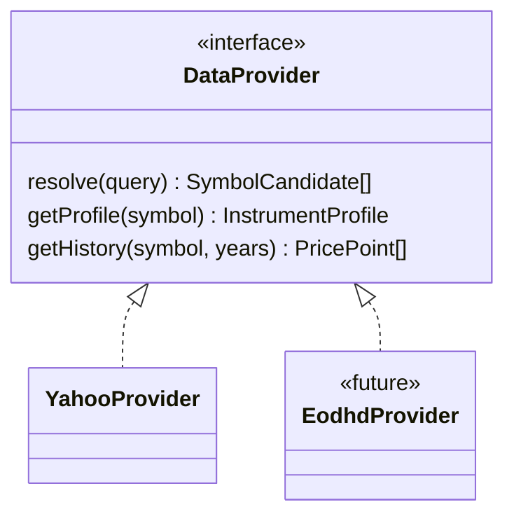

# Technical details

## 1. Caching



- Memory LRU is capped at **500** entries. The file cache is best-effort: write failures are ignored.
- In-flight de-duplication means 10 concurrent requests for `AAPL` produce one upstream call.
- Benchmark data is cached like any other symbol, so the default `VWCE.DE` is almost always a hit.
- `.cache/` is git-ignored. Delete it to force a refresh.

## 2. Security and abuse limits



| Control            | Value                                                                                                                              |
| ------------------ | ---------------------------------------------------------------------------------------------------------------------------------- |
| Search query       | ≤ 40 chars, `/^[\w .&-]+$/`                                                                                                        |
| Symbols            | `/^[A-Za-z0-9.\-=^]{1,20}$/`                                                                                                       |
| Upstream timeouts  | OpenFIGI 8 s (`AbortSignal.timeout`), Yahoo 9 s (`Promise.race`), Anthropic 20 s                                                   |
| Summary rate limit | 10 requests/min per IP (`x-forwarded-for` → `x-real-ip`), in memory, max 1000 IPs tracked                                          |
| Summary body       | `Content-Length` checked first, then real byte length ≤ 100 000                                                                    |
| Summary payload    | `slimReport` whitelist: only known fields, lists ≤ 10, strings truncated                                                           |
| Secrets            | `ANTHROPIC_API_KEY`, `OPENFIGI_API_KEY` only read in route handlers; not in the client bundle (checked by grepping `.next/static`) |
| Cache file names   | key sanitized to `[a-zA-Z0-9._-]` + sha1 suffix, so no path traversal                                                              |

The rate limiter and the memory cache are **per process**. On serverless or multi-instance deployments they are best-effort; use a shared store (e.g. Redis/Upstash) for real limits.

## 3. AI summary validation

The model receives only the slim JSON. Its output is accepted only if **every** check passes.



Rules worth knowing:

- `8%` against a source of `0.0812` passes (8.12 rounded to 0 decimals = 8). `8%` against `0.0862` fails.
- `+34%` against `-0.34` fails. An unsigned `34%` passes, because drawdowns are often written without the sign.
- Large amounts must be written as full integers (`416.161.000.000`): "416,2 miliardi" is rejected.
- **Known limit:** matching is against the pool of all input numbers, not per field. A real number attached to the wrong metric would pass.

On failure the route retries once, then returns `{summary: null}` and the UI hides the section.

## 4. Testing

```bash
npm test          # vitest, pure modules
npx tsc --noEmit  # types
npm run lint
npm run build
```

| Test file                   | Covers                                                                                                                     |
| --------------------------- | -------------------------------------------------------------------------------------------------------------------------- |
| `metrics.test.ts`           | CAGR (incl. short history, elapsed span), volatility, drawdown with dates, rebase alignment, monthly closes, rolling range |
| `profileFit.test.ts`        | Each statement and status, it-IT formatting, forbidden-word regex over all texts                                           |
| `profileValidation.test.ts` | Ranges, strict numeric parsing (`1e3`, `0x14` rejected), warnings                                                          |
| `summaryValidation.test.ts` | One case per validator rule (rounding, sign, dates, years, number words, forbidden stems)                                  |
| `report.test.ts`            | Report notes contain no forbidden words                                                                                    |

There are no tests that hit Yahoo or Anthropic. Those paths were verified manually against the dev server.

## 5. Known limits

| Area          | Limit                                                                                  | Mitigation                                                 |
| ------------- | -------------------------------------------------------------------------------------- | ---------------------------------------------------------- |
| Data source   | Yahoo is unofficial: no SLA, may rate-limit (429) or change shape                      | Cache, provider interface, plan to move to EODHD           |
| ETF TER       | Missing for some UCITS listings (e.g. VWCE.DE)                                         | Shows "Dato non disponibile"                               |
| ETF countries | Not provided by Yahoo                                                                  | Hidden / "Dato non disponibile"                            |
| Holdings      | Top ~10 only                                                                           | —                                                          |
| FX            | Returns are in listing currency; no EUR conversion                                     | Note added when instrument and benchmark currencies differ |
| Stock labels  | Sector/country are Yahoo's English strings                                             | —                                                          |
| Summary trust | Route summarises whatever the client sends (numbers validated against that same input) | Acceptable: there are no accounts and no shared output     |
| Chart a11y    | `aria-label` only, no data table                                                       | Future: add a visually hidden table                        |

## 6. Swapping the data provider (e.g. EODHD)



1. Add `src/lib/data/eodhd.ts` implementing `DataProvider`, mapping:
   - `General.Name`, `ETF_Data.Ongoing_Charge` to `ter`;
   - `Top_10_Holdings`, `Sector_Weights` and `World_Regions` to `holdings`, `sectors` and `countries`.
2. Use EODHD symbols (`VWCE.XETRA`) or map them from the Yahoo suffixes.
3. In `src/lib/report.ts`, choose the provider by env, e.g. `process.env.EODHD_API_KEY ? eodhdProvider : yahooProvider`.
4. Clear `.cache/`, because the keys do not include the provider name.

## 7. Environment variables

| Variable            | Required | Purpose                                                  |
| ------------------- | -------- | -------------------------------------------------------- |
| `ANTHROPIC_API_KEY` | no       | Enables the AI summary; without it the section is hidden |
| `ANTHROPIC_MODEL`   | no       | Defaults to `claude-haiku-5-5`                           |
| `OPENFIGI_API_KEY`  | no       | Higher OpenFIGI rate limits for ISIN lookup              |
